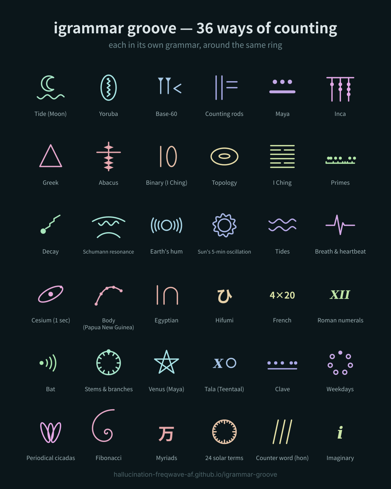

# igrammar groove — Open Rhythm Collaboration / 共同制作のご案内

📄 **PDF:** [igrammar_groove_collaboration.pdf](igrammar_groove_collaboration.pdf)

36 ways of counting, around the same ring. What happens when your rhythm joins them?
36の数え方が、同じ輪を回る。あなたのリズムが加わったら、何が生まれる？

---

## English

### The project, in three stages
1. **Stage 1** — You play over an igrammar groove video. One seat — the Tala lane — is left empty for you.
2. **Stage 2** — The machine steps out. Only the human performances are layered, each in its own cycle. Third beats are born between people.
3. **Stage 3** — If we both like how it sounds, dreaming majo turns it into a video — in Para grooveat, a style where image and sound move on deliberately different rhythms.

### How to join
**Tempo: 120 BPM** — that is the only fixed rule. How many beats make one cycle is up to you. Bring your own tradition: Teentaal 16, a 12-beat bell pattern, 7, anything.

Two small requests, so the performances can be lined up later:
- Tell us your cycle in one line (for example: *Teentaal, 16 beats*).
- Start with a count-in or a few claps, so your beat 1 can be found.

Ways to send it:
- **Instagram Remix** of the igrammar groove video (left: igrammar groove, right: you).
- Or a video / audio file by DM.
- Or open the app in your browser and play along: https://hallucination-freqwave-af.github.io/igrammar-groove/

### Credit and use
- You keep the rights to your own performance.
- If we both feel it works, we would love to make it into a video. Every performer used is always credited by name or handle.
- Not every performance will be used — only the ones that fit the piece. Thank you for understanding.
- Once a video is finished and published, it is hard to take a part out. If you do not want your performance used in a video, please tell us when you send it.
- The counting machine is made with AI (Claude). The performances stay fully human — that contrast is the point.

---

## 日本語

### 企画の流れ（3段階）
1. **第1段階** — 異文法グルーヴの動画に合わせて叩いてもらいます。ターラの席を一つ空けてあります。
2. **第2段階** — 機械が抜けて、送られてきた演奏だけを重ねます。周期の違いから、人と人の間に第3の拍が生まれます。
3. **第3段階** — お互いに「ええな」と思えたら、dreaming majo が映像作品にします。映像と音をわざと別のリズムで動かす、パラグルビート（Para grooveat）という作り方です。

### 参加のしかた
**テンポ：BPM 120** — 決まりはこれだけです。何拍で一周するかは自由です。ティーンタールの16拍、12拍のベルパターン、7拍、どんな伝統でも歓迎します。

あとで並べるために、お願いが二つあります。
- 何拍で一周しているかを一言添えてください（例：Teentaal, 16 beats）。
- 頭にカウントか手拍子を入れてください。1拍目を揃えるのに使います。

送り方：
- 異文法グルーヴの動画を **Instagram のリミックス**で（左に異文法グルーヴ、右にあなた）
- または、動画か音声ファイルを DM で
- または、ブラウザでアプリを開いて一緒に鳴らす：https://hallucination-freqwave-af.github.io/igrammar-groove/

### クレジットと使い方
- 演奏の権利はあなたのものです。
- お互いに「ええな」と思えたら、映像作品にさせてください。使わせてもらった演奏には、必ず名前かアカウント名を載せます。
- 送っていただいた演奏を全部使うとは限りません。作品に合うものだけを使わせてもらいます。
- 作品を完成させて公開した後は、一部だけ外すのが難しくなります。映像に使ってほしくない場合は、送る時に一言伝えてください。
- 数える機械は AI（Claude）と作りました。演奏は全部人間のものです。その対比が、この企画の中心です。

---

Contact / 連絡先：Instagram **@hallucination_freqwave_af** · https://hallucination-freqwave-af.github.io
